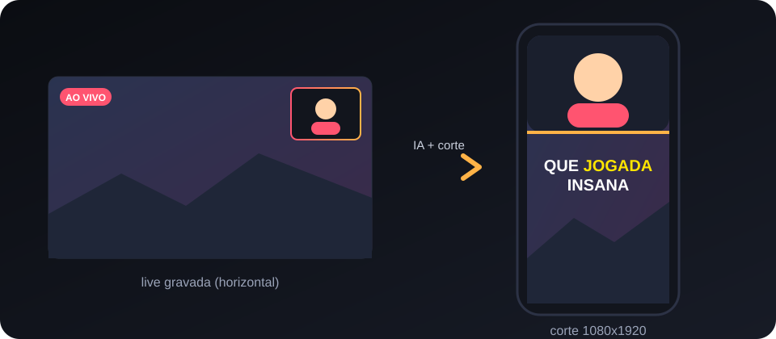

# CortaLive Básico

**Transforme um vídeo ou uma live gravada em cortes verticais prontos para TikTok, YouTube Shorts e Instagram Reels — com legenda palavra a palavra, título de gancho e texto do post.**

Grátis e de código aberto (licença MIT). Roda no seu PC, com a **sua** chave de IA.

<p align="center">
  
</p>

---

## O que ele faz

1. **Você entrega** um vídeo (MP4, MKV, TS…) ou a pasta com os blocos `.ts` de uma live gravada.
2. **Ele encontra os momentos fortes** pelos picos de áudio (grito, risada, explosão, comemoração).
3. **Ele transcreve** cada momento no seu PC (Whisper, sem mandar áudio para a internet).
4. **A IA escolhe** os melhores momentos, dá nota de 0 a 10 e escreve título, legenda e hashtags.
5. **Ele corta em vertical 1080x1920**: webcam em cima e jogo embaixo (quando acha a webcam) ou a imagem centralizada sobre um fundo desfocado, com legenda queimada, título nos primeiros segundos e crédito ao criador.

Para cada corte você recebe, na pasta `saida`:

| Arquivo | O que é |
|---|---|
| `…mp4` | o corte vertical 1080x1920, pronto para postar |
| `…jpg` | a capa (frame do momento com o título) |
| `…_POST.txt` | título, legenda do post, **crédito ao criador do vídeo original** e hashtags — é só copiar e colar |
| `…json` | dados técnicos (tempos, nota, transcrição) |

---

## Básico x Pro

O Básico é a porta de entrada: **só corta**. O **CortaLive Pro** faz o ciclo inteiro sozinho.

| | Básico (grátis) | Pro |
|---|:---:|:---:|
| Corta vídeo/live gravada que você já tem | ✅ | ✅ |
| IA escolhe os momentos e escreve título/legenda | ✅ | ✅ |
| Legenda palavra a palavra + capa + texto do post | ✅ | ✅ |
| Resolução do corte | 1080x1920 | **até 4K (2160x3840)** |
| Usa também o **chat ao vivo** para achar os melhores momentos | — | ✅ |
| **Grava lives sozinho** (Twitch, YouTube, Kick) | — | ✅ |
| **Publica sozinho** no TikTok, YouTube Shorts e Instagram Reels | — | ✅ |
| Agenda de publicação, com pausa geral e por rede | — | ✅ |
| Painel com agenda, métricas das contas e análise | — | ✅ |
| Suporte | comunidade (Issues) | por e-mail |

👉 **Conheça o Pro:** https://srsatriano.github.io/CortaLive-Basico/

---

## Requisitos

- **Windows 10 ou 11** (64 bits)
- **Python 3.11 ou mais novo** — https://www.python.org/downloads/
- **ffmpeg** (ferramenta gratuita de vídeo) — o `CORTAR.bat` oferece instalar sozinho
- **~3 GB livres** (programa + modelo de transcrição) e espaço para os cortes
- Internet na primeira vez (para baixar as dependências e o modelo de transcrição) e para a IA
- Uma chave de IA (**opcional**, mas recomendada — veja abaixo)

PC recomendado: processador de 4 núcleos ou mais e 8 GB de RAM. Não precisa de placa de vídeo.

---

## Instalação passo a passo (sem precisar saber programar)

### 1. Instale o Python

1. Entre em https://www.python.org/downloads/ e clique no botão amarelo **Download Python**.
2. Abra o instalador. **Antes de clicar em Install, MARQUE a caixinha “Add python.exe to PATH”** (fica embaixo, na primeira tela).
3. Clique em **Install Now** e espere terminar.

### 2. Baixe o CortaLive Básico

1. Baixe a versão mais recente: **[CortaLive Básico (ZIP)](https://github.com/SrSatriano/CortaLive-Basico/releases/latest)** → em *Assets*, clique em **Source code (zip)**.
   (Ou, nesta página, botão verde **Code** → **Download ZIP**.)
2. Clique com o botão direito no ZIP → **Extrair tudo…** → escolha uma pasta fácil, por exemplo `Documentos\CortaLive`.

### 3. Rode pela primeira vez

1. Abra a pasta extraída e dê dois cliques em **`CORTAR.bat`**.
2. Na primeira vez ele prepara tudo sozinho (leva alguns minutos):
   - cria um ambiente só do programa (pasta `.venv`) e instala as dependências;
   - se faltar o **ffmpeg**, ele pergunta se pode instalar com o `winget` — responda **S**;
     (se ele instalar o ffmpeg, feche a janela e abra o `CORTAR.bat` de novo);
   - cria o arquivo **`.env`** com as configurações padrão.

> Se o Windows mostrar “O Windows protegeu o computador”, clique em **Mais informações → Executar assim mesmo**. Isso aparece com qualquer arquivo `.bat` baixado da internet.

### 4. (Recomendado) Coloque a sua chave de IA

Abra o arquivo **`.env`** com o Bloco de Notas (botão direito → Abrir com → Bloco de Notas), cole a sua chave na linha certa e salve. Exemplo:

```
GEMINI_API_KEY=cole-a-sua-chave-aqui
```

Sem chave o programa funciona, mas escolhe os momentos só pelo volume e usa títulos genéricos.

---

## Chave de IA: como pegar a sua

Você precisa de **uma** destas (pode ter mais de uma; ele tenta na ordem e usa a próxima se uma falhar). A chave é sua: o uso é cobrado (ou descontado da cota grátis) direto na sua conta do provedor. **Nunca compartilhe o seu `.env`.**

| IA | Onde pegar | Linha no `.env` |
|---|---|---|
| **Google Gemini** (tem cota gratuita, bom para começar) | https://aistudio.google.com/apikey → **Create API key** | `GEMINI_API_KEY=` |
| **Claude** (Anthropic) | https://console.anthropic.com/settings/keys → **Create Key** (precisa colocar créditos em *Billing*) | `ANTHROPIC_API_KEY=` |
| **OpenAI** | https://platform.openai.com/api-keys → **Create new secret key** (precisa de créditos em *Billing*) | `OPENAI_API_KEY=` |
| **Vertex AI** (Google Cloud, para quem tem créditos no Google Cloud) | veja abaixo | `VERTEX_CRED=` |

**Vertex AI (Google Cloud), passo a passo:**

1. Em https://console.cloud.google.com/ crie (ou escolha) um projeto com faturamento ativo.
2. Ative a API do Vertex AI: https://console.cloud.google.com/apis/library/aiplatform.googleapis.com → **Ativar**.
3. Em https://console.cloud.google.com/iam-admin/serviceaccounts crie uma **conta de serviço** com o papel **Usuário do Vertex AI** (*Vertex AI User*).
4. Na conta criada: **Chaves → Adicionar chave → Criar nova chave → JSON**. Um arquivo `.json` será baixado.
5. Guarde o arquivo **fora** da pasta do programa e coloque o caminho no `.env`:
   `VERTEX_CRED=C:\Users\voce\Documentos\minha-conta-de-servico.json`

Tem mais de uma chave? Escolha qual tentar primeiro com `IA=gemini` (ou `claude`, `openai`, `vertex`).

Para conferir se está tudo certo, abra o terminal na pasta do programa e rode:

```
.venv\Scripts\python -m cortalive testar --ia
```

---

## Como usar

### Jeito fácil

**Arraste o vídeo e solte em cima do `CORTAR.bat`.** Ele pergunta o nome do criador do vídeo original (para os créditos) e começa. No fim, abre a pasta `saida` ao lado do vídeo.

Também funciona com **uma pasta** cheia de blocos `.ts` de uma live gravada: arraste a pasta inteira. Os blocos são juntados em ordem de nome (`parte2` vem antes de `parte10`).

### Pelo terminal (para quem prefere)

```
.venv\Scripts\python -m cortalive cortar "C:\Videos\minha live.mp4"
```

Opções:

| Opção | Para quê |
|---|---|
| `--canal "Nome do Criador"` | nome que vai nos créditos (padrão: nome do arquivo) |
| `--plataforma Twitch` | onde o vídeo original está (aparece nos créditos) |
| `--saida "C:\Cortes"` | pasta dos cortes (padrão: `saida` ao lado do vídeo) |
| `--max-cortes 5` | quantos cortes no máximo, os de nota mais alta (padrão 10; `0` = sem limite) |
| `--refazer` | esquece o que já foi feito nesse vídeo e começa de novo |
| `--trabalhadores 1` | analisa uma parte por vez (PC mais fraco) |

**Parou no meio?** Rode o mesmo comando de novo: ele continua de onde parou e não repete cortes já feitos.

### Quanto tempo leva?

Depende muito do PC e do tamanho do vídeo: a parte mais pesada é a transcrição, que roda no processador. Comece com um vídeo curto para ter uma ideia no seu computador. A primeira vez é mais demorada porque baixa o modelo de transcrição (~500 MB). PC mais fraco? Use `WHISPER_MODELO=base` no `.env`.

### Configurações

Tudo fica no arquivo `.env` (cada linha está explicada no `.env.exemplo`). As mais usadas:

| Configuração | Padrão | O que faz |
|---|---|---|
| `MAX_CORTES` | `10` | máximo de cortes por vídeo |
| `CORTE_MIN_SEG` / `CORTE_MAX_SEG` | `72` / `150` | duração dos cortes, em segundos (o TikTok só paga vídeos com mais de 1 minuto) |
| `NOTA_MINIMA` | `6.5` | nota mínima da IA para virar corte |
| `TEMA` | vazio | assunto do canal (ex.: `Minecraft`), ajuda a IA nos títulos |
| `MARCA` | vazio | marca d'água no vídeo (ex.: `@seucanal`); vazio = desligada |
| `HASHTAGS_FIXAS` | `#cortes #shorts` | hashtags que vão em todo post |
| `WHISPER_MODELO` | `small` | `tiny`/`base` = mais rápido; `medium` = mais preciso e mais lento |
| `WHISPER_IDIOMA` | `pt` | idioma falado no vídeo |

---

## Perguntas frequentes

**Preciso pagar alguma coisa?**
O CortaLive Básico é grátis. A IA é cobrada pelo provedor que você escolher, na sua conta (o Gemini tem cota gratuita). Sem chave ele também funciona, só que sem a IA.

**Meu vídeo ou minha chave vão para algum servidor do CortaLive?**
Não. Tudo roda no seu PC. A transcrição é feita localmente. Só o **texto** da transcrição de cada momento vai para a IA que **você** configurou, direto do seu PC.

**Funciona com vídeo em inglês/espanhol?**
Sim: troque `WHISPER_IDIOMA=en` (ou `es`) no `.env`. Os títulos e legendas são escritos em português.

**Não achou nenhum momento. E agora?**
Vídeos com som muito constante (música alta o tempo todo, por exemplo) têm poucos picos. Tente diminuir `NOTA_MINIMA` (ex.: `5`) ou aumentar `MAX_CORTES`. Sem chave de IA, só os picos mais fortes viram corte.

**A câmera do streamer não apareceu em cima.**
O programa só monta “câmera em cima, jogo embaixo” quando encontra um rosto fixo e pequeno num canto da tela. Se não encontrar, usa a imagem inteira centralizada — o corte sai do mesmo jeito.

**Deu erro “ffmpeg não encontrado”.**
Abra o PowerShell e rode `winget install -e --id Gyan.FFmpeg`. Feche e abra o `CORTAR.bat` de novo.

**Onde fica o log?**
Em `dados\estado\cortalive.log`, dentro da pasta do programa.

**Ele posta nas redes sozinho?**
Não. O Básico só corta e escreve o texto do post. Gravação automática de lives, publicação automática, agenda e métricas estão no **CortaLive Pro**.

**Quero o corte em 4K.**
O 4K é exclusivo do Pro. O Básico sempre gera 1080x1920, que é a resolução padrão das três redes.

---

## ⚠️ Aviso de responsabilidade: direitos autorais e de imagem

O CortaLive é uma ferramenta. **Você é o único responsável pelo que corta e publica.**

- Só corte vídeos que você tem **direito ou permissão** de usar: o seu próprio conteúdo ou o de criadores que autorizam cortes (muitos streamers têm regras públicas para isso — leia antes).
- **Dê sempre o crédito ao criador do vídeo original.** O programa coloca o crédito no vídeo e no texto do post; não apague.
- **Respeite as regras de cada plataforma** (TikTok, YouTube, Instagram) e as regras do criador original — inclusive pedidos de remoção.
- Músicas, imagens e trechos de terceiros dentro do vídeo podem ter direitos próprios.
- O software é fornecido “no estado em que se encontra”, sem garantia (veja a licença MIT).

---

## Para quem vai mexer no código

```
python -m venv .venv
.venv\Scripts\python -m pip install -r requirements-dev.txt
.venv\Scripts\python -m pytest
.venv\Scripts\python -m ruff check .
```

Estrutura do pacote `cortalive/`:

| Módulo | Função |
|---|---|
| `__main__.py` | linha de comando (`cortar`, `testar`) |
| `cortador.py` | o pipeline: janelas, retomada, seleção dos melhores, render |
| `detector.py` | picos de áudio e ajuste das bordas em pausas de fala |
| `transcrever.py` | Whisper local com tempo por palavra (com cache) |
| `curador.py` | prompt da IA, validação da resposta e plano B sem IA |
| `llm.py` | Gemini, Claude, OpenAI e Vertex por HTTP, com a sua chave |
| `layout.py` | detecta a webcam (YuNet / OpenCV) |
| `legendas.py` | gera o `.ass` (legenda, título, crédito, marca d'água) |
| `render.py` | um ffmpeg só: vertical + legenda + áudio normalizado + capa |
| `trechos.py`, `util.py`, `config.py` | ffmpeg/ffprobe, utilidades e configuração |

A página do produto fica em `docs/` (GitHub Pages: *Settings → Pages → Branch `main`, pasta `/docs`*).

## Licença

Código sob [licença MIT](LICENSE) © 2026 SrSatriano. Fontes (SIL OFL 1.1) e modelo de rosto YuNet (MIT) têm licenças próprias: veja [`recursos/LICENCAS.md`](recursos/LICENCAS.md).
